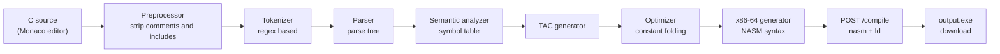
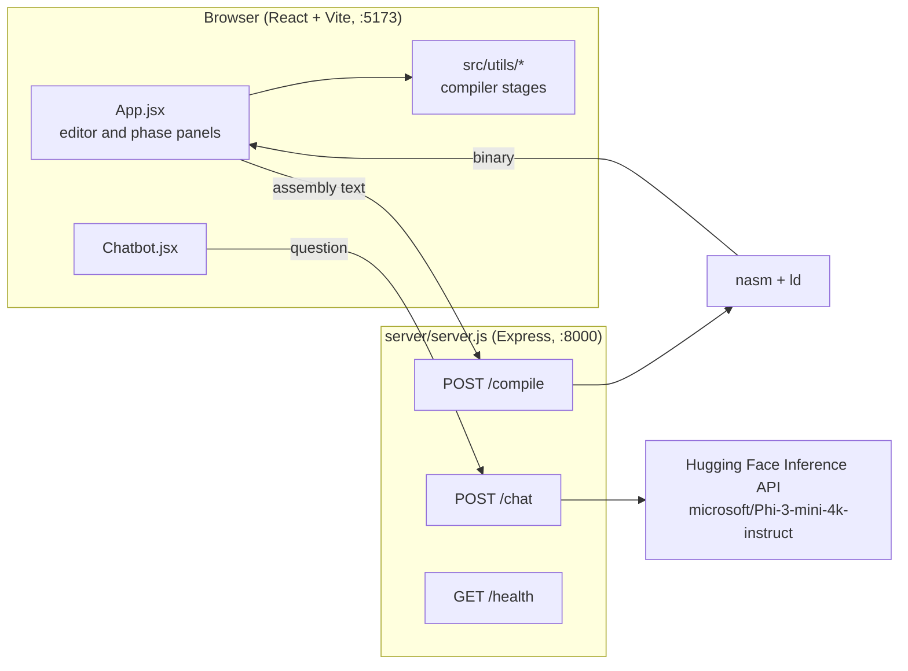

# C-Compiler

A browser-based visualizer that runs a small subset of C through every compiler phase, shows the output of each one, and assembles the result with NASM.


## Overview

You write C in a Monaco editor and press **Compile**. Every phase of the front end and back end is implemented by hand in JavaScript under `src/utils/` and runs in the browser:

1. Preprocessing
2. Lexical analysis (tokenizer)
3. Syntax analysis (recursive descent parser, rendered as a tree)
4. Semantic analysis (symbol table with declaration and usage lines)
5. Three-address code (TAC) generation
6. TAC optimization (constant folding and propagation)
7. x86-64 assembly generation (NASM syntax)

The generated assembly is then posted to a small Express server, which runs `nasm` and `ld` and sends back the linked binary as a download. A chat panel answers questions about compiler phases through the Hugging Face Inference API.

## Compilation pipeline



## Architecture



## Features

- **Preprocessor**: removes `//` and `/* */` comments and `#include <...>` lines, and records each header with its line number so later phases can report line numbers against the original source.
- **Tokenizer**: classifies `KEYWORD`, `IDENTIFIER`, `NUMBER`, `STRING`, `OPERATOR` and `PUNCTUATION`, each tagged with its line.
- **Parser**: enforces `int main()` as the entry point, `type name = expression;` declarations, `return expression;`, terminating semicolons and matching braces and parentheses. Throws a `SyntaxError` with a line number on violation.
- **Semantic analyzer**: builds a symbol table (name, type, scope, declaration line, usage lines) and reports redeclared or undeclared variables.
- **TAC generator**: emits three-address code with temporaries `t0, t1, ...`.
- **Optimizer**: folds constant expressions and propagates known values, collapsing the function body to the final value of the returned variable.
- **Assembly generator**: emits a `section .data` / `section .text` NASM program with a `_start` entry point that writes each constant result to stdout through the `write` syscall and then exits.
- **Executable**: the server assembles with `nasm -f win64` and links with `ld`, then streams `output.exe` back to the browser.
- **Chatbot**: greetings and "what are the phases" questions get canned answers; any question that mentions a compiler phase is sent to Phi-3-mini with a short or detailed prompt depending on wording; anything else is declined.

## Repository structure

```
C-Compiler/
├── index.html
├── package.json              # frontend deps; "dev" starts Vite and the server together
├── vite.config.js
├── eslint.config.js
├── public/
│   └── vite.svg
├── src/
│   ├── main.jsx
│   ├── App.jsx               # editor, Compile handler, one panel per phase
│   ├── App.css
│   ├── index.css
│   ├── assets/react.svg
│   ├── components/
│   │   ├── Chatbot.jsx
│   │   ├── Chatbot.css
│   │   └── CodeInput.jsx     # not used by App.jsx
│   └── utils/
│       ├── preprocessor.jsx
│       ├── tokenizer.jsx
│       ├── parser.jsx
│       ├── semanticAnalyzer.jsx
│       ├── threeAddressCodeGenerator.jsx
│       ├── optimizer.jsx
│       └── x86ARMGenerator.jsx   # emits x86-64 only, despite the name
└── server/
    ├── server.js             # /compile, /chat, /health on port 8000
    ├── context.txt           # chatbot context, loaded at startup
    ├── package.json
    └── temp.obj              # build leftover checked into the repo
```

## Getting started

### Prerequisites

- Node.js and npm
- [NASM](https://www.nasm.us/) and a GNU `ld` on your `PATH` (needed only for the final `/compile` step; if the server is running without them, the phase panels still render and the compile step reports an error)
- A Hugging Face access token (needed only for the chatbot)

### Install

```bash
git clone https://github.com/fakubwoy/C-Compiler.git
cd C-Compiler
npm install
cd server && npm install && cd ..
```

The server loads `axios` and `dotenv` from the root `node_modules`, so install both.

### Configure

Create `server/.env`:

```
HUGGINGFACE_API_KEY=your_token_here
```

### Run

```bash
npm run dev
```

This uses `concurrently` to start Vite (http://localhost:5173) and the Express server (http://localhost:8000). Check the server with `curl http://localhost:8000/health`.

## Example

Input:

```c
#include <stdio.h>
int main() {
    int a = 5;
    int b = a + 3;
    return b;
}
```

**Preprocessed code** (header recorded as `stdio.h` on line 1):

```c
int main() {
    int a = 5;
    int b = a + 3;
    return b;
}
```

**Tokens**: 21 tokens, for example `{"type":"KEYWORD","value":"int","line":1}`.

**Parse tree**:

```
└── Program: Root
    └── Function: main
        ├── Declaration: int a
        │   └── Number: 5
        ├── Declaration: int b
        │   └── Expression: +
        │       ├── Identifier: a
        │       └── Number: 3
        └── Return: return
            └── Identifier: b
```

**Symbol table** (lines refer to the original source):

| Symbol | Type | Scope | Declared | Used |
|--------|------|-------|----------|------|
| a      | int  | main  | 3        | 4    |
| b      | int  | main  | 4        | 5    |

**Three-address code**:

```
func main {
a = 5
t0 = a + 3
b = t0
return b
}
```

**Optimized TAC**:

```
func main {
b=8
return b
}
```

**x86-64 assembly**:

```nasm
section .data
    val0 db '8', 0xA
section .text
global _start
_start:
    mov rax, 1
    mov rdi, 1
    mov rsi, val0
    mov rdx, 2
    syscall
    mov rax, 60
    xor rdi, rdi
    syscall
```

The program writes `8` to stdout and exits with status 0.

## Limitations and known gaps

- **Small language subset.** The parser understands one `int main()` function containing `int`/`float` declarations with an initializer and `return` statements. Other statements (`if`, loops, `printf`, plain assignments) are skipped without an error. Function parameters are not parsed.
- **No operator precedence.** Binary expressions are parsed right-recursively, so `2 * 3 + 4` is evaluated as `2 * (3 + 4)`.
- **Errors do not stop the pipeline.** A failed semantic check is shown, but TAC, optimization and code generation still run.
- **Constant-only back end.** The optimizer uses `eval` to fold expressions, and the assembly generator only emits code for values that folded to a constant. It never uses registers or the stack for variables, and the exit status is always 0.
- **Target mismatch.** The assembly uses Linux `write`/`exit` syscalls with a `_start` entry, while the server assembles with `nasm -f win64` and names the output `output.exe`. The resulting binary is unlikely to run correctly on either Windows or Linux without changing the NASM format and linker step to match.
- **Chatbot endpoint.** The server calls `api-inference.huggingface.co`, the legacy serverless Inference API. `context.txt` is loaded but not included in prompts.
- **Error handler bug.** The `catch` block in `App.jsx` calls `setX86ARMCode`, which is not defined, so a parse error also raises a second error in the console.
- **Hardcoded URLs.** The frontend calls `localhost` directly, so it only works when the browser and server run on the same machine.

## Contributors

- Farhaan Khan ([@fakubwoy](https://github.com/fakubwoy))
- Aditya Sareen
